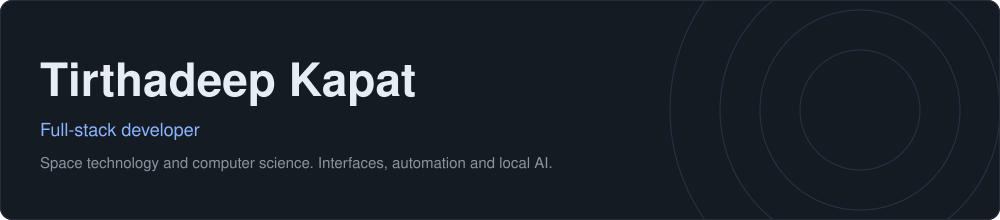
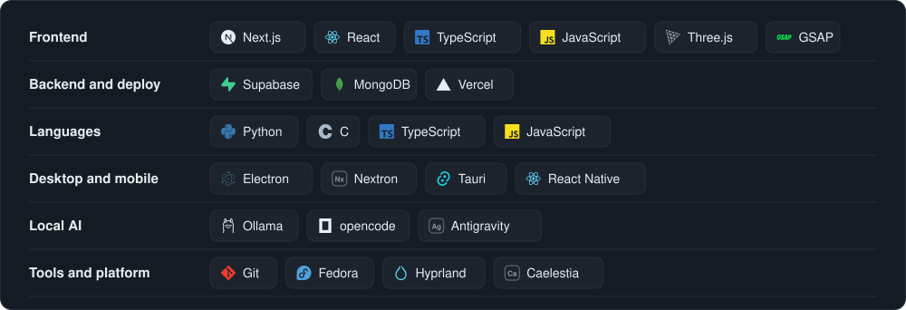
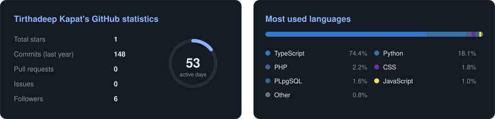
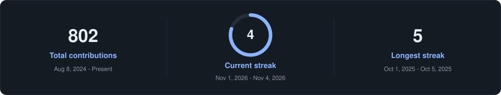

<picture>
<source media="(prefers-color-scheme: dark)" srcset="assets/static/header-dark.svg">
<source media="(prefers-color-scheme: light)" srcset="assets/static/header-light.svg">

</picture>

## About

Web-Dev, Computer Automation, IoT, System Architecture
**Astronomy**, **Space Technologies**.  

- **Subjects** : Mathematics, Astronomy, Physics, Computer Science.

- Currently building [Radscope](https://github.com/Tkapat/radscope), a radio telescope mount controller
- Daily stack: Next.js+MERN and Python
- Setup: Fedora, Hyprland, Caelestia

## Socials

<a href="https://www.linkedin.com/in/tirthadeep-kapat-41a583324/"><picture>
<source media="(prefers-color-scheme: dark)" srcset="assets/static/social-linkedin-dark.svg">
<source media="(prefers-color-scheme: light)" srcset="assets/static/social-linkedin-light.svg">

</picture></a>&nbsp;
<a href="https://www.instagram.com/tdkapat/"><picture>
<source media="(prefers-color-scheme: dark)" srcset="assets/static/social-instagram-dark.svg">
<source media="(prefers-color-scheme: light)" srcset="assets/static/social-instagram-light.svg">

</picture></a>&nbsp;
<a href="mailto:tirthadeepkapat06@gmail.com"><picture>
<source media="(prefers-color-scheme: dark)" srcset="assets/static/social-email-dark.svg">
<source media="(prefers-color-scheme: light)" srcset="assets/static/social-email-light.svg">

</picture></a>&nbsp;
<a href="https://github.com/Tkapat"><picture>
<source media="(prefers-color-scheme: dark)" srcset="assets/static/social-github-dark.svg">
<source media="(prefers-color-scheme: light)" srcset="assets/static/social-github-light.svg">

</picture></a>

## Featured work

| Project | What it is |
| --- | --- |
| **[Radscope](https://github.com/Tkapat/radscope)** | Radio telescope mount controller. A desktop app with a live 3D sky map and satellite tracking, plus ESP32 firmware that drives NEMA 21 stepper motors over WebSockets. *(React, TypeScript, Three.js, Tauri, C++)* [Live interface](https://radscope.vercel.app) |
| **[NAZAR](https://github.com/Tkapat/NAZAR_dev_skill)** |It is the monitoring systemm for government funded training centers. It helps to keep proof and track of the real usage of the equipments funded by development.  *(SIH project, [Stack])* |
| **Local Assistant** | Computer automation assistant that runs entirely on-device, with no cloud service involved. *(Python, gemma2:2b, private build)* |

## Skills

<picture>
<source media="(prefers-color-scheme: dark)" srcset="assets/static/skills-dark.svg">
<source media="(prefers-color-scheme: light)" srcset="assets/static/skills-light.svg">

</picture>

## GitHub statistics

<picture>
<source media="(prefers-color-scheme: dark)" srcset="assets/generated/stats-dark.svg">
<source media="(prefers-color-scheme: light)" srcset="assets/generated/stats-light.svg">

</picture>

<picture>
<source media="(prefers-color-scheme: dark)" srcset="assets/generated/activity-dark.svg">
<source media="(prefers-color-scheme: light)" srcset="assets/generated/activity-light.svg">

</picture>

<picture>
<source media="(prefers-color-scheme: dark)" srcset="assets/generated/heat-dark.svg">
<source media="(prefers-color-scheme: light)" srcset="assets/generated/heat-light.svg">

</picture>
